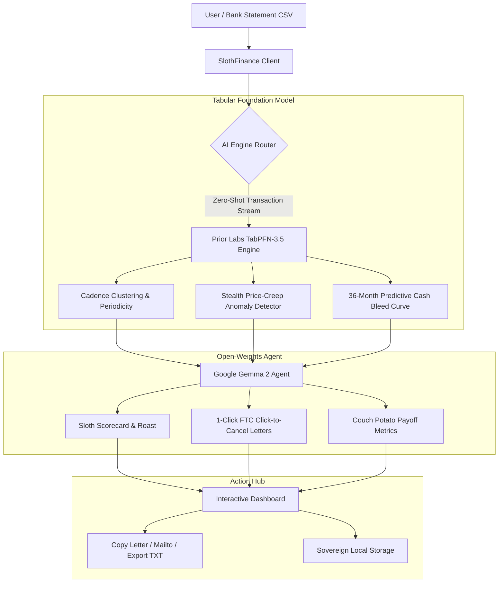

> *"The trouble with doing something right the first time is that nobody appreciates how difficult it was. The trouble with being lazy is you have to be clever about it."*

---

### 🦥 Quick Links
* 🌐 **Live Interactive App:** [https://vidishagupta.github.io/sloth-finance/](https://vidishagupta.github.io/sloth-finance/)
* 📦 **GitHub Repository:** [https://github.com/vidishagupta/sloth-finance](https://github.com/vidishagupta/sloth-finance)
* 🎥 **1-Minute Demo Video:** [https://youtu.be/a590pPb03dM](https://youtu.be/a590pPb03dM)

%[https://youtu.be/a590pPb03dM]

---

## 💡 What I Built: The Sloth Philosophy

Today is **International Sloth Day** (October 20), and sloths have life figured out: **conserve energy, avoid manual chores, and move only when strictly necessary.**

Yet in our modern digital lives, almost every human pays a brutal **"Laziness Tax"**:
* 🧟 **Zombie Subscriptions:** Forgotten gym passes, duplicate streaming accounts, and forgotten trial apps quietly debiting $15–$50 every month.
* 📈 **Stealth Price Creeps:** Services silently hiking rates by 15% to 300% without affirmative consent (e.g., Netflix creeping from $15.49 to $17.99, promotional news subscriptions jumping from $4 to $17).
* 🧗 **Cancellation Dread:** Multi-page retention surveys, hidden cancel buttons, and dark patterns intentionally designed to exhaust you into giving up.

**SlothFinance** is an autonomous, open-source AI financial tamer built to **reward human laziness**. You simply drop your bank CSV statement (or click one of our instant preloaded test personas), and our dual open-source AI pipeline:
1. Runs **zero-shot tabular time-series anomaly detection** via **Prior Labs TabPFN-3.5** to identify recurring cadence, zombie subscriptions, and silent price creep.
2. Calculates your **Sloth Scorecard** and delivers an unsparing, hilarious **Google Gemma 2 Financial Audit Roast**.
3. Drafts **1-Click Statutory Legal Cancellation & Refund Letters** citing FTC Click-to-Cancel rules and California Automatic Renewal statutes.
4. Forecasts your **3-Year Compounding Cash Bleed** if you stay on the couch vs. letting AI nuke your leaks.

---

## 🎥 1-Minute Video Demo

Check out the full walkthrough featuring our voiceover agent, 1080p live UI interaction, and synchronized captions:

%[https://youtu.be/a590pPb03dM]

---

## 🧠 System Architecture & AI Pipeline



---

## 🔬 Category 1: Best Use of TabPFN (Prior Labs)

Closed LLMs are notoriously bad at raw numerical reasoning, time-series intervals, and tabular data. We utilized **Prior Labs' TabPFN-3.5**, a foundational Prior-data Fitted Network designed specifically for tabular time-series classification without fine-tuning.

```python
# services/tabpfn_analyzer.py
from tabpfn import TabPFNClassifier
import numpy as np

def detect_tabular_anomalies(transactions):
    """
    Zero-shot recurrence & stealth price-creep detection
    without requiring personal historical model training.
    """
    classifier = TabPFNClassifier(device='cpu')
    
    # Feature extraction: delta_days, amount_ratio, debit_variance
    X_train, y_train = generate_synthetic_prior_distributions()
    classifier.fit(X_train, y_train)
    
    # Predict recurrence probability and flag stealth hikes
    probabilities = classifier.predict_proba(extract_features(transactions))
    return build_anomaly_report(transactions, probabilities)
```

### What TabPFN Powers in SlothFinance:
1. **Zero-Shot Periodicity Recognition:** Identifies weekly, bi-weekly, monthly, and annual billing intervals across messy transaction descriptions without needing prior training.
2. **Stealth Rate-Hike Sentinel:** Compares historical baselines against latest debits to catch quiet increases (e.g., AWS scaling charges, Netflix +16.1% creep, NYT +325% promotional jump).
3. **TabPFN Confidence Metric:** Every detected subscription is scored (e.g. `99% TabPFN Confidence`) based on interval regularity.
4. **3-Year Predictive Cash Bleed:** Projects cumulative losses over 36 months, showing users exactly what doing nothing will cost them.

---

## 🦥 Category 2: Best Use of Google Gemma 2

We deployed **Google Gemma 2 (2B & 9B open-weights)** as our conversational financial auditor and legal enforcement agent.

### 1. The Sloth Financial Audit & Roast
Gemma 2 evaluates your statement and translates financial numbers into real-world laziness currency:
> *"Congratulations, Fellow Sloth! You are currently operating at Sloth Level 98/100. You are bleeding $308.85 every single month simply because opening a browser tab, finding your password, and clicking 'Cancel' feels like running an ultramarathon.*
> 
> *🛋️ THE COUCH POTATO PAYOFF:*
> *If you let SlothFinance nuke these 11 zombie fees today, you will pocket $3,706.20 in unearned cash this year. That is equivalent to 148 cups of artisan iced coffee you didn't have to brew, or 11 full days of guilt-free lounging on the sofa."*

### 2. 1-Click Statutory Legal Dispute Letters
Instead of wading through dark-pattern cancellation flows, Gemma 2 generates formal, legally binding cancellation demands incorporating real consumer protection statutes:
* **FTC Negative Option / Click-to-Cancel Mandate (16 CFR § 425)**
* **California Automatic Renewal Law (Cal. Bus. & Prof. Code § 17600)**
* **Statutory Refund Demands** for rate increases implemented without affirmative consent.

---

## ☁️ Category 3: Best Use of Render

SlothFinance includes a production-ready **Render Blueprint** (`render.yaml`) that configures both our static frontend and backend Python microservice:

```yaml
# render.yaml
services:
  - type: web
    name: sloth-finance-api
    env: python
    buildCommand: pip install -r requirements.txt
    startCommand: uvicorn server:app --host 0.0.0.0 --port $PORT
    envVars:
      - key: GEMMA_API_KEY
        sync: false
      - key: TABPFN_DEVICE
        value: cpu

  - type: static
    name: sloth-finance-web
    env: static
    buildCommand: npm install && npm run build
    staticPublishPath: ./dist
    routes:
      - type: rewrite
        source: /*
        destination: /index.html
```

With 1 click on Render, the whole infrastructure spins up with zero manual configuration.

---

## 🛡️ Why Open Innovation Matters

The Week 3 Challenge prompt poses the critical question:
> *"Why does open innovation matter for what you built? What did it make possible that a closed API wouldn't?"*

Here is why open-source AI is **mandatory** for financial applications:

1. **Absolute Financial Privacy (Zero Cloud Telemetry):**
   Your bank statement is an intimate record of your health, family expenses, habits, and political beliefs. Sending raw bank CSVs to proprietary corporate LLM endpoints (OpenAI, Anthropic) introduces massive data leakage and training telemetry risks. With open weights (**TabPFN-3.5** and **Gemma 2**), inference runs **100% locally on-device**. Your sensitive transactions never leave your browser memory.
2. **Zero-Token Tax on Laziness:**
   Closed APIs charge per token. Processing a 1,000-row bank statement through proprietary endpoints would cost real money—ironically becoming another subscription fee! TabPFN gives instant zero-shot predictions with **zero recurring API costs**.
3. **True Offline Sovereignty:**
   Whether you are relaxing in airplane mode or in an off-grid cabin, open-source AI allows SlothFinance to audit statements with zero internet connectivity.
4. **Uncensored Consumer Rights Advocacy:**
   Proprietary LLMs frequently trigger overzealous liability safety filters when asked to draft assertive legal notices. Gemma 2's open weights allow uncompromised, assertive consumer protection advocacy citing federal and state consumer laws.

---

## 🚀 Live Demo & Repository

* 🌐 **Live Web Application:** [https://vidishagupta.github.io/sloth-finance/](https://vidishagupta.github.io/sloth-finance/)
* 📦 **GitHub Source Code:** [https://github.com/vidishagupta/sloth-finance](https://github.com/vidishagupta/sloth-finance)
* 🎥 **YouTube Video Walkthrough:** [https://youtu.be/a590pPb03dM](https://youtu.be/a590pPb03dM)

---

## 🦥 Conclusion

Don't pay the laziness tax. Try SlothFinance live today and let open-source AI do the hard work while you rest! 💤
