<div align="center">

# 🦥 SlothFinance
### Autonomous Open-Source AI Financial Tamer That Rewards Laziness
**Built for the DEV Hacktoberfest 2026 Week 3 Challenge: *Slow and Steady* (International Sloth Day)**

[](https://dev.to/challenges/hacktoberfest-week3-2026-10-19)
[](https://platform.priorlabs.ai)
[](https://ai.google.dev/gemma)
[](https://render.com)
[](https://sloth-finance-ten.vercel.app)
[](https://dev.to/vidisha_gupta_/slothfinance-the-autonomous-open-source-ai-financial-tamer-that-rewards-your-laziness-5bp5)
[](LICENSE)
[](https://youtu.be/a590pPb03dM)

<br/>

**[🌐 Live Demo (GitHub Pages)](https://vidishagupta.github.io/sloth-finance/)** • **[⚡ Live Mirror (Vercel)](https://sloth-finance-ten.vercel.app)** • **[📝 DEV Submission Article](https://dev.to/vidisha_gupta_/slothfinance-the-autonomous-open-source-ai-financial-tamer-that-rewards-your-laziness-5bp5)** • **[🎥 Watch 1-Min Video Demo](https://youtu.be/a590pPb03dM)** • **[🚀 Render Blueprint Deploy](https://render.com)**

</div>

---

## 🎥 1-Minute Video Walkthrough

[](https://youtu.be/a590pPb03dM)
*(Click above to watch the 1-minute full walkthrough with AI voiceover and synchronized subtitles)*

---

## 🌟 The Philosophy: Why "Slow and Steady"?

Tomorrow is **International Sloth Day**, and sloths have life figured out: **they move at their own pace, conserve energy, and avoid unnecessary effort.**

Yet in our modern digital lives, humans lose hundreds or thousands of dollars every year to **financial inertia**:
- 🧟 **Zombie Subscriptions:** Forgotten free trials that quietly converted to full recurring bills.
- 📈 **Stealth Price Creeps:** Streaming platforms and SaaS tools quietly hiking rates by $2 to $5/month without explicit affirmative consent.
- 🧗 **Unsubscribe Dread:** Companies intentionally construct dark patterns (hidden cancel buttons, mandatory phone calls, multi-page retention surveys) because they know you are too tired to bother.

**SlothFinance** is an open-source AI agent engineered to **reward your laziness**. Drop in your bank CSV statement, and our dual open-source AI pipeline audits your recurring leaks, calculates your Sloth Scorecard, and writes 1-click legal cancellation and dispute letters while you stay comfortable on the couch.

---

## 🧠 System Architecture & AI Pipeline

```mermaid
graph TD
    A[User / Bank Statement CSV] --> B[SlothFinance Client]
    B --> C{AI Engine Router}
    
    subgraph Tabular Foundation Model
    C -->|Zero-Shot Transaction Stream| D[Prior Labs TabPFN-3.5 Engine]
    D --> E[Cadence Clustering & Periodicity]
    D --> F[Stealth Price-Creep Anomaly Detector]
    D --> G[36-Month Predictive Cash Bleed Curve]
    end

    subgraph Open-Weights Agent
    E & F & G --> H[Google Gemma 2 Agent]
    H --> I[Sloth Scorecard & Roast]
    H --> J[1-Click FTC Click-to-Cancel Letters]
    H --> K[Couch Potato Payoff Metrics]
    end

    subgraph Action Hub
    I & J & K --> L[Interactive Dashboard]
    L --> M[Copy Letter / Mailto / Export TXT]
    L --> N[Pre-filled DEV.to Submission Generator]
    end
```



---

## ⚡ Key Features

### 1. 🔬 Prior Labs TabPFN-3.5 Tabular Anomaly Engine
- **Zero-Shot Periodicity Detection:** Detects weekly, bi-weekly, monthly, and annual cadences without needing model re-training or fine-tuning on personal data.
- **Stealth Rate-Hike Sentinel:** Compares historical transaction baselines against current debits to immediately isolate price increases (e.g., Netflix creeping from $15.49 to $17.99 or The New York Times jumping from $4.00 promotional rate to $17.00).
- **Confidence Rating:** Each subscription receives a TabPFN confidence percentage based on interval regularity and debit pattern.

### 2. 🦥 Google Gemma 2 Agent & 1-Click Legal Letters
- **The Sloth Scorecard & Roast:** Evaluates your financial inertia score (0 to 100) and calculates how many days of guilt-free lounging or cups of artisan coffee you could reclaim by cancelling zombies.
- **Statutory Consumer Rights Letters:** Drafts assertive, polite cancellation notices incorporating statutory citations:
  - **FTC Negative Option / "Click-to-Cancel" Mandate** (prohibiting deceptive auto-renewals).
  - **California Automatic Renewal Law (CA AB 390 / Bus. & Prof. Code § 17600)**.
  - Statutory demand for refund credits on price increases executed without affirmative consent.

### 3. 📈 Compounding Cash Bleed Forecast
- Visual interactive SVG trajectory contrasting **Status Quo (Doing Nothing)** vs. **SlothFinance (Nuking Top 3 Leaks)** over 3, 6, 12, 24, and 36 months.

### 4. 🚀 1-Click Instant Preloaded Scenarios
- **The Forgetful Developer:** AWS bill spikes, multiple AI copilots, creeping Netflix, and untouched gym memberships.
- **College Student Chaos:** Duolingo, Chegg, Tinder Gold, and food delivery passes.
- **Zombie SaaS Overload:** Duplicate Notion, Figma, Loom, and ghost cloud droplets.

---

## 🛡️ Why Open Innovation Matters

The Hacktoberfest Week 3 theme explicitly asks: *“Why does open innovation matter for what you built? What did it make possible that a closed API wouldn't?”*

1. **Absolute Financial Privacy:**
   Bank statements contain the most intimate financial footprint of human life (medical expenses, personal habits, political donations, family needs). Sending raw statement CSVs to closed commercial APIs exposes users to telemetry and third-party data collection. Open-weights models (**TabPFN** and **Gemma 2**) run **100% locally on-device**.
2. **Zero-Token Tax on Laziness:**
   Closed token-based APIs charge users per token. Auditing a 1,000-row CSV on proprietary endpoints would cost real money—ironically becoming another subscription fee! TabPFN gives instant zero-shot predictions with **zero recurring token costs**.
3. **True Offline Sovereignty:**
   SlothFinance operates seamlessly in airplane mode or off-grid cabins. Zero internet connection required.
4. **Uncensored Consumer Rights Advocacy:**
   Proprietary commercial models often trigger overzealous liability safety filters when prompted to generate assertive legal dispute notices. Gemma 2's open weights allow uncompromised consumer protection advocacy.

---

## 🛠️ Quickstart & Local Setup

### Frontend (React + Vite)
```bash
# Clone the repository
git clone https://github.com/vidishagupta/sloth-finance.git
cd sloth-finance

# Install dependencies
npm install

# Start local development server
npm run dev
```
Open [http://localhost:5173](http://localhost:5173) in your browser.

### Backend (Python FastAPI + TabPFN + Gemma API)
```bash
# Create and activate virtual environment
python -m venv venv
source venv/bin/activate  # On Windows: venv\Scripts\activate

# Install dependencies
pip install -r requirements.txt

# Run FastAPI server
uvicorn server:app --host 0.0.0.0 --port 8000 --reload
```
Open [http://localhost:8000/docs](http://localhost:8000/docs) for the interactive Swagger API documentation.

---

## ☁️ Deployment

### Deploy to Render (1-Click Blueprint)
This repository includes a native `render.yaml` blueprint.
1. Connect this repo to [Render](https://render.com).
2. Render will automatically spin up the static frontend and Python FastAPI service according to `render.yaml`.

### Deploy to Vercel
```bash
npx vercel deploy
```

---

## 🏆 Hacktoberfest 2026 Prize Categories
- **Best Use of TabPFN:** Powers the zero-shot tabular time-series classification, stealth price creep anomaly detection, and 3-year cash bleed forecast.
- **Best Use of Gemma:** Google Gemma 2 powers the conversational Sloth Auditor, financial roast, and statutory cancellation letters.
- **Best Use of Render:** Full-stack deployment with native `render.yaml` infrastructure blueprint.
- **Overall Top Winner Track**

---

## 📄 License
Released under the **MIT License**. Built with ❤️ for Hacktoberfest 2026.
